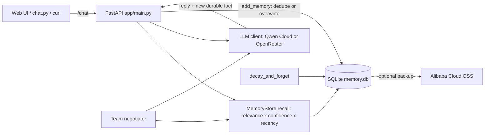

# MemoryAgent

**Track 1: MemoryAgent**, Global AI Hackathon with Qwen Cloud.

A personal assistant that builds durable knowledge about each user (preferences, allergies, constraints) across sessions, recalls only the memories relevant to the current question instead of replaying the whole history, forgets stale information over time, and lets teams of users combine their constraints in a shared "negotiator" chat.

**Links:** [GitHub](https://github.com/shriram-s7/QWEN-CLOUD-MEMORY-AGENT)

## Overview

Most chat assistants forget everything when a session ends, so users keep re-explaining themselves. MemoryAgent keeps the memory in a small store that it controls, separate from the language model: the model (Qwen Cloud or OpenRouter) is swappable, while the memory persists. Each turn is sent to the model with a handful of recalled memories; the model also flags new durable facts, which are saved. Memories lose confidence with disuse and are deleted when they fall below a floor, and a new fact that closely matches an old one overwrites it, so corrections replace outdated facts.

## Features

**Memory**
- Per-user SQLite memory store with categories (for example `preference`), confidence and last-accessed time.
- Recall scored by relevance x confidence x recency (a 30-day half-life by default), with a small baseline boost for preferences; relevance uses embeddings when available and falls back to token overlap.
- Dedupe/overwrite of near-duplicate memories, decay and hard-delete forgetting (`POST /maintenance/decay`), memory export and manual delete.

**Accounts and chat**
- Signup/login with hashed passwords and expiring session tokens; multiple conversations per user.
- Web chat UI (`static/`) with a model selector, memory viewer and a command-line client (`chat.py`).

**Teams**
- Create teams, invite users, accept or decline, share facts with a team.
- Team negotiator chat and `POST /negotiate`: each member's relevant memories are turned into constraints for a goal (for example "where should we travel?") and the model proposes a recommendation that respects all of them.

**Providers**
- Qwen Cloud (OpenAI-compatible endpoint) or OpenRouter, switchable at runtime with `POST /providers/set`. With no API key the app runs in a **mock mode** that returns templated replies and simple rule-based memory extraction.

## How it works



See `docs/architecture.svg` for the original diagram. `alibaba_deploy/` contains an OSS backup helper (`oss_backup.py`), a Function Compute handler (`fc_handler.py`, `s.yaml`) and an ECS setup script (`ecs_deploy.sh`).

## Tech stack

| Layer | Technology |
|---|---|
| Backend | Python, FastAPI, Uvicorn, Pydantic |
| Storage | SQLite |
| LLM | Qwen Cloud (DashScope international, OpenAI-compatible) or OpenRouter via the `openai` SDK |
| Embeddings | OpenRouter `text-embedding-3-small`, else Qwen `text-embedding-v3`, else token overlap |
| Frontend | Plain HTML, CSS and JavaScript |
| Deployment helpers | Alibaba Cloud OSS (`oss2`), Function Compute (`mangum`), ECS script |

## Project structure

```text
app/main.py          FastAPI routes (auth, chat, memories, teams, negotiator, providers)
app/memory.py        MemoryStore: users, sessions, memories, conversations, teams
app/qwen_client.py   LLM client for Qwen / OpenRouter, mock mode, negotiator prompts
static/              web UI (index.html, app.js, style.css)
chat.py, demo.py     command-line chat client and scripted cross-session demo
test_e2e.py          offline end-to-end script (mock mode)
alibaba_deploy/      OSS backup, Function Compute and ECS deployment helpers
docs/architecture.svg
```

## Getting started

Prerequisites: Python 3.10 to 3.12 (the pinned dependencies did not install on Python 3.14 when tried).

**Windows (PowerShell)**

```powershell
python -m venv venv
.\venv\Scripts\Activate.ps1
pip install -r requirements.txt
$env:QWEN_API_KEY = "<your-key>"     # optional; omit for mock mode
uvicorn app.main:app --host 127.0.0.1 --port 8000
```

**Linux / macOS**

```bash
python3 -m venv venv && source venv/bin/activate
pip install -r requirements.txt
export QWEN_API_KEY="<your-key>"     # optional; omit for mock mode
uvicorn app.main:app --host 127.0.0.1 --port 8000
```

Open http://127.0.0.1:8000 for the web UI. Environment variables are listed in [`.env.example`](.env.example): `QWEN_API_KEY`, `OPENROUTER_API_KEY`, `LLM_PROVIDER` (`qwen` or `openrouter`), `LLM_MODEL`, and `MEMORY_DB_PATH` (default `memory.db`). The app reads real environment variables, not a `.env` file. Never commit real keys.

## Usage

1. Sign up in the web UI and tell the assistant something durable, such as "I am vegetarian and allergic to peanuts".
2. Start a new chat, even after restarting the server, and ask for a dinner recipe; the stored facts are recalled.
3. Open the memory viewer to see, export or delete memories.
4. Create a team, invite another user, and use the team chat to negotiate a shared goal.

Command-line alternatives: `python chat.py` (interactive client) or `python demo.py` (scripted cross-session recall).

## Tests

```bash
python test_e2e.py
```

This is a script rather than a pytest suite. It runs fully offline in mock mode: it signs up users, builds memories, and checks that a team chat recalls "dislikes Africa". Observed while writing this README (Python 3.10): it ran to the end and printed "Africa dislike in team constraints: YES". There is no assertion framework and no test run against a live model.

## Status and limitations

- Working prototype built for a hackathon; it optimises for demonstrating the memory mechanism, not for production security or multi-tenant use.
- Real Qwen or OpenRouter behaviour was not exercised while writing this README (no API keys); only mock mode was run.
- The Alibaba Cloud deployment helpers are included, but a live deployment was not verified here.
- Recall quality depends on embeddings being available; without them it falls back to simple token overlap.
- SQLite file storage, development defaults and no rate limiting.
- `Project Implementation` is the original working brief (a "Personal Context Engine" vision) and is kept as notes.

## License

MIT, see [`LICENSE`](LICENSE).
